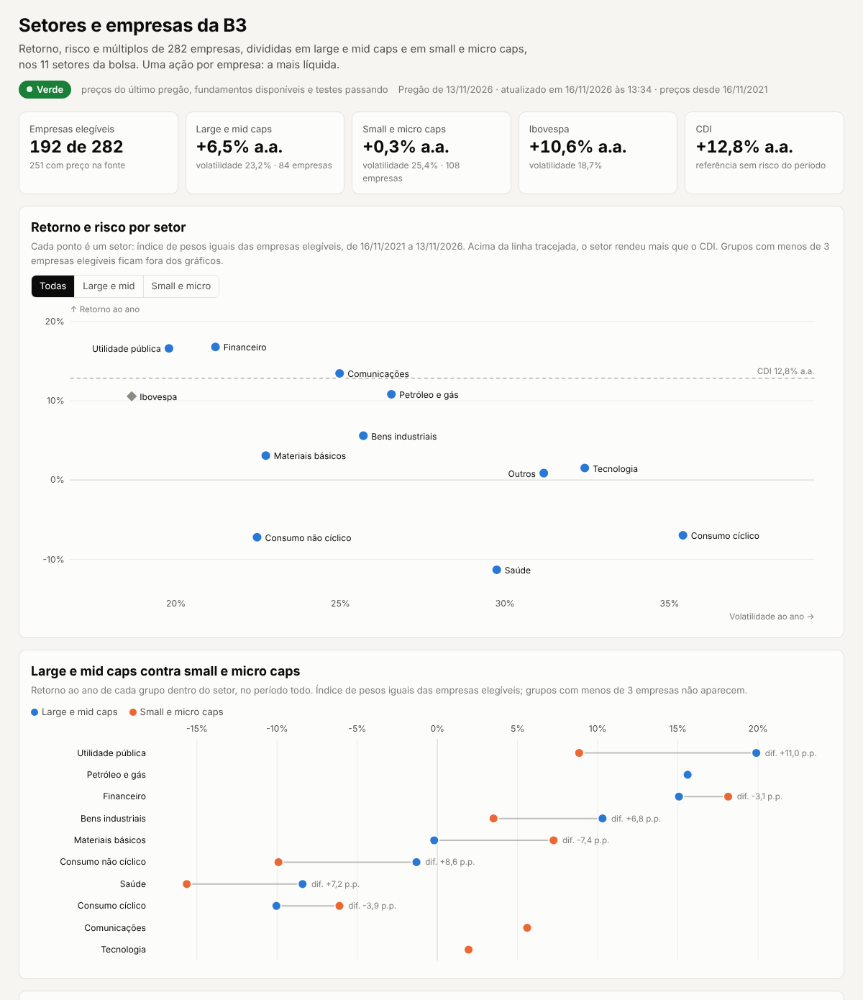

# Setores e empresas da B3: retorno, risco e múltiplos

[](https://github.com/mlsantos92/setores-b3/actions/workflows/atualizar.yml)
**[Ver painel ao vivo](https://mlsantos92.github.io/setores-b3/)** · atualizado em dias úteis às 08h30 e 19h15, com selo de situação.

Estudo de **282 empresas da B3**, divididas em large e mid caps e em small e micro caps, nos 11 setores da bolsa. Para cada empresa e cada setor: retorno em 5 anos, volatilidade, maior queda, Sharpe e múltiplos (P/L, P/VP, EV/EBITDA, dividend yield, ROE).

**Perguntas:** quais setores pagaram o risco que correram? As small caps renderam mais que as grandes? Onde os múltiplos estão acima ou abaixo da mediana do setor?

> Material de estudo. Nenhum resultado deste repositório é recomendação de compra ou de venda.



## Principais leituras (retrato de 13/11/2026, 5 anos)

- **Nenhum grupo bateu o CDI.** O CDI rendeu 12,8% ao ano no período. O índice de pesos iguais das large e mid caps rendeu 6,5% ao ano; o das small e micro caps, 0,3% ao ano. O Ibovespa, que pesa por valor de mercado, rendeu 10,6% ao ano.
- **Só três setores ficaram acima do CDI:** Financeiro (16,8% a.a.), Utilidade Pública (16,6% a.a.) e Comunicações (13,4% a.a.). Os dois primeiros também tiveram a menor volatilidade.
- **Os piores:** Saúde (−11,3% a.a.), Consumo Não Cíclico (−7,2% a.a.) e Consumo Cíclico (−7,0% a.a.). O Consumo Cíclico teve a maior volatilidade (35,4%).
- **Tamanho ajudou na maioria dos setores.** As large e mid caps renderam mais que as small e micro caps em 7 dos 11 setores. As exceções: Financeiro, Materiais Básicos, Consumo Cíclico e Tecnologia. Em quatro setores um dos grupos tem menos de 3 empresas elegíveis, então a comparação ali é frágil.
- **Small caps são mais baratas nos múltiplos, com motivo:** P/L mediano de 6,8 contra 12,0 das grandes e P/VP de 0,90 contra 1,39, com ROE menor (10,9% contra 14,3%).

Os números mudam a cada atualização; o painel traz sempre o retrato mais recente.

## Do universo ao painel

| Etapa | Empresas |
|---|---|
| Lista original (large e mid caps: 89; small e micro caps: 193) | 282 |
| Com preço na fonte, após ajustes de código | 251 |
| Fora dos agregados por dado suspeito (salto de preço de um dia) | 9 |
| Fora dos agregados por pouca liquidez | 50 |
| **Elegíveis: entram nos índices e nas medianas dos setores** | **192** |

As 31 empresas sem preço são as que saíram da bolsa (Neoenergia, Santos Brasil, Carrefour Brasil, Banco Pan, entre outras) e as que a fonte não cobre. A lista completa, com o motivo quando conhecido, está no fim do painel.

## Decisões de método

- **Uma ação por empresa.** Quando a lista traz ON, PN e unit, fica o código de maior volume financeiro mediano nos últimos 60 pregões.
- **Códigos que mudaram.** A lista original não é alterada. As trocas de código (ELET3 → AXIA3, CCRO3 → MOTV3, EMBR3 → EMBJ3, ODPV3 → SAUD3 e outras) e as saídas da bolsa ficam em [`data/raw/ajustes_tickers.json`](data/raw/ajustes_tickers.json).
- **Retorno total.** Os preços são ajustados por proventos, então o retorno inclui dividendos reinvestidos.
- **Índice do setor com pesos iguais**, rebalanceado todo dia, só com empresas elegíveis. Não é investível e difere dos índices setoriais da B3, que pesam por valor de mercado. Por isso o estudo mostra a empresa típica do setor, não a maior.
- **Elegíveis:** negócio em pelo menos 90% dos pregões dos últimos 12 meses e giro mediano de ao menos R$ 100 mil por dia.
- **Dado suspeito:** alta de mais de 100% ou queda de mais de 80% em um dia costuma ser grupamento ou troca de código que a fonte não ajustou. A empresa aparece na tabela com a marca e fica fora dos agregados.
- **Múltiplos por mediana**, não por média: um P/L de 130 não distorce o setor. P/L só existe para empresas com lucro; o painel conta quantas têm prejuízo.
- **Dividend yield calculado aqui:** proventos pagos em 12 meses ÷ preço atual. Acima de 30% é descartado.

## Limitações

- **Viés de sobrevivência.** A lista foi montada em 2026. Empresas que quebraram ou saíram da bolsa antes não entram, o que melhora o retorno histórico, sobretudo das small caps.
- **Fonte única e gratuita.** Preços e indicadores vêm do Yahoo Finance. Os múltiplos não foram conferidos contra os demonstrativos da CVM; valores fora de faixas plausíveis são descartados, mas erros dentro da faixa passam.
- **Setores pequenos.** Comunicações, Tecnologia e Outros têm poucas empresas elegíveis. Grupos com menos de 3 empresas ficam fora dos gráficos.
- **Feriados locais.** O calendário desconta feriados nacionais. Em feriado só da B3, o selo pode ficar amarelo por um dia.
- **Classificação dos setores** é a da lista original, sem revisão.

## Como funciona

| Etapa | Onde |
|---|---|
| Universo e ajustes de código | `data/raw/`, `src/setores_b3/universo.py` |
| Coleta (Yahoo Finance e CDI do Banco Central) | `src/setores_b3/coleta.py` |
| Retorno, volatilidade, maior queda, Sharpe, índice de pesos iguais | `src/setores_b3/metricas.py` |
| Limpeza dos múltiplos e mediana do setor | `src/setores_b3/multiplos.py` |
| Escolha do código, elegibilidade e agregados | `src/setores_b3/estudo.py` |
| Calendário de pregões e selo de situação | `src/setores_b3/calendario.py`, `src/setores_b3/selo.py` |
| Painel estático | `docs/index.html`, que lê `docs/dados.json` |
| Atualização diária | `.github/workflows/atualizar.yml` |

Só o módulo de coleta fala com a rede. Os cálculos recebem tabelas prontas, o que permite testar tudo sem internet: são 25 testes com dados sintéticos (`pytest`).

**Selo:** verde quando pelo menos 95% das large e mid caps têm preço do último pregão fechado, há fundamentos para 80% das elegíveis e os testes passam. Amarelo quando algum desses pontos falha. Vermelho quando a coleta ou os testes quebram.

## Como rodar

```bash
git clone https://github.com/mlsantos92/setores-b3
cd setores-b3
python -m venv .venv && source .venv/bin/activate   # Windows: .venv\Scripts\activate
pip install -r requirements.txt

pytest -q                          # testes, sem internet
TESTES_OK=1 python scripts/atualizar.py   # coleta e gera docs/dados.json (uns 3 minutos)
python -m http.server -d docs 8000        # painel em http://localhost:8000
```

## Licença

MIT. Os dados pertencem às suas fontes.
